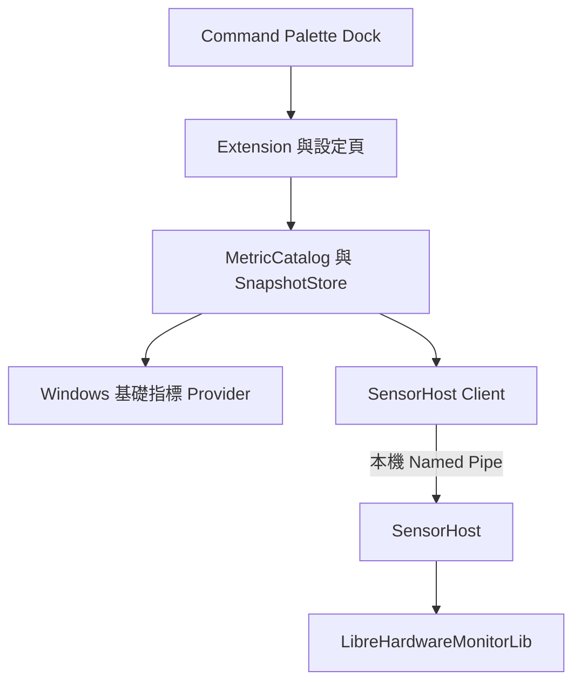

# CmdPalDockStats 開發計畫

日期：2026-09-30  
狀態：規劃文件；尚未建立應用程式或完成 Windows 實機驗證。

## 1. 專案目標

建立獨立的 PowerToys Command Palette Extension：**CmdPalDockStats**，在 Dock Band 持續顯示使用者挑選的系統指標，涵蓋 CPU、GPU、RAM、磁碟、網路、硬體感測器與電池。

核心價值是「可自行選擇的硬體溫度與系統狀態」：使用者能指定 CPU Package、GPU Core、GPU Hotspot、SSD、主機板等實際存在的感測器，自訂顯示名稱與排列順序。硬體未提供的資訊不得以推估值冒充實測。

本文件的版本選擇、預設值、架構與驗收門檻均為專案設計決策；外部 API 能力以第 15 節來源為依據，硬體相容性以後續實測為準。

## 2. 範圍與產品定位

PowerToys Dock 已提供 Performance Monitor 類型的 Band [S2]。本專案主要差異是感測器瀏覽、自訂組合、明確的溫度來源與讀取失敗診斷。

### 第一版必須完成

- 一組可自訂內容與順序的 My Stats Dock Band。
- CPU 使用率、RAM 使用量、磁碟讀寫速率與容量、網路上下行、電池狀態。
- GPU 使用率、VRAM 與溫度：依裝置及 Provider 支援情況提供。
- 溫度優先的 Sensor Explorer，列出實際偵測到的裝置、感測器、單位與狀態。
- CPU／GPU 溫度的端到端實機驗證，包括必要時啟用較高權限的 SensorHost；不得只做出模擬數據介面就視為溫度功能完成。
- 使用者可新增／移除指標、選擇裝置與感測器、調整順序、名稱、單位及更新頻率。
- 設定持久化、重啟後還原、缺失感測器提示、採樣失敗隔離。
- 診斷頁顯示資料來源、最後更新時間、權限及相容性問題。

### 後續擴充

- 多個自訂 Band、配置預設集、設定匯入／匯出。
- 個別指標釘選、門檻通知、短期歷史、趨勢圖可行性研究。
- 風扇、電壓、功率、時脈等已由 Provider 提供的感測器可先瀏覽及釘入 My Stats；專用介面與進階分析後續再做。
- ARM64 基礎指標另行驗證；不得直接宣稱與 x64 相同的溫度支援度。

### 不納入第一版

- 風扇控制、超頻、電壓調整或任何硬體寫入操作。
- 雲端帳號、遠端電腦監控、長期資料庫或背景上傳。
- 自製桌面 Dock、任意 XAML 小工具、取代工作管理員。
- 所有品牌、所有感測器、所有驅動版本的完整支援保證。

## 3. 技術基線與前置驗證

| 項目 | 決策與限制 |
| --- | --- |
| 平台 | Windows 11 x64 優先；最低 OS 組建以選定的官方 Extension 範本及實測結果設定 |
| 語言／Runtime | C#，優先 .NET 10；以範本與 SDK 實際相容性確認 TFM |
| Extension SDK | Dock 文件要求 `Microsoft.CommandPalette.Extensions >= 0.9.260303001`；Toolkit 採相容版本並鎖定 [S1] |
| PowerToys | 使用具有 Dock 的版本；SDK 版本不等於 PowerToys 版本，M0 記錄最低已驗證宿主版本 |
| UI | Command Palette SDK 的 ListPage／ListItem／設定或表單介面；不自行接管 Dock 視窗 |
| 感測器 | `LibreHardwareMonitorLib` 為主要硬體感測 Provider [S3] |
| 一般指標 | Windows API／PDH／.NET 網路與磁碟 API，以低權限可用為目標 |
| 設定 | 具 `schemaVersion` 的本機 JSON，原子寫入與遷移 |
| IPC | 本機 Named Pipe，採樣程序與 Extension 分離 |
| 發行 | 先 GitHub Release 的 Extension 安裝套件＋獨立 SensorHost 安裝流程；Store／WinGet 後續驗證 |

M0 必須從官方範本建立最小可安裝 Extension，實際驗證 SDK、Toolkit、.NET、封裝及 Dock；不要僅根據文件中的最低 NuGet 版本判斷可執行性。鎖定 NuGet 相依版本與 lock file，記錄宿主版本和 LHM release/tag，不直接依賴浮動 master 或 nightly。

## 4. 架構與權限

採用 **一般權限 Extension + Windows 基礎 Provider + 獨立 SensorHost**。



### 4.1 職責

- **Extension**：提供 Band、設定、指標選擇、詳細資訊與診斷；不直接操作核心驅動。
- **Windows Provider**：CPU、RAM、網路、磁碟及電池等基本資訊；各來源可獨立失敗。
- **SensorHost**：集中管理 LHM 初始化、硬體列舉、遞迴更新、快取與資源釋放。先支援一般權限啟動，必要時由使用者明確啟用提升權限的模式。
- **SnapshotStore**：合併不同來源的不可變快照；Dock 更新只讀快照，不在 SDK callback 中執行硬體 I/O。

### 4.2 溫度與權限策略

LHM 明確說明部分感測器需要管理員權限 [S3]。因此不能要求使用者把整個 PowerToys 以系統管理員身分常駐，也不能承諾單純提權就能讀到所有溫度。

1. 首次使用先提供一般指標及可讀取的感測器。
2. 使用者在「啟用進階感測器」頁主動啟動提升權限的 SensorHost；取消 UAC 後保留基本功能。
3. 第一版先採本次登入期間的 helper 程序，無客戶端超過 60 秒即退出；不預設安裝常駐 Windows Service 或建立提權排程。
4. 核心存取元件的安裝與感測程序提權分開處理。LHM release 已涉及 PawnIO 相依元件 [S4]，應依鎖定版本確認實際需要的驅動、授權、安裝方式與簽章，不能假設 NuGet 安裝後全部可用。
5. 元件缺失、驅動遭阻擋、硬體不支援或權限不足分別呈現。不得引導使用者停用 Memory Integrity、Secure Boot 或驅動封鎖措施。
6. 背景服務與登入自動啟動留到後續版本，另評估多使用者權限、安裝、更新及移除生命週期。

### 4.3 IPC 邊界

- 只允許本機連線；Pipe ACL 限定發起者 SID 與必要的系統帳戶，隔離不同使用者與工作階段。
- 驗證客戶端身分與握手協定版本；M0 測試同帳號提權及使用另一管理員帳號核准 UAC 的差異，無法安全對應時拒絕連線並顯示原因。
- 只提供列舉、訂閱、讀取快照、健康檢查等有限操作；不接受命令列、任意路徑、DLL 載入、硬體寫入或任意驅動操作。
- 對訊息長度、指標數量、採樣頻率與逾時設上限；拒絕未知版本與格式錯誤。
- Helper 執行檔及相依檔放在受保護的安裝位置；避免以較高權限載入使用者可修改的程式檔。
- 無遠端 HTTP endpoint；程序異常時退避重連，不能反覆跳出 UAC。

## 5. 指標與資料來源

以下是實作選擇，所有 Provider 都需回報能力與讀取狀態；「列入功能」不代表每台電腦都能提供該指標。

| 分類 | 第一版指標 | 候選資料來源 | 語意與限制 |
| --- | --- | --- | --- |
| CPU | 整體使用率、Package／Core 溫度；可用時時脈及功率 | 使用率以 PDH；感測器以 LHM | Package、Core Max、Tctl/Tdie 各自標示，不互稱為同一種溫度 |
| GPU | 各 GPU 使用率、VRAM、Core／Hotspot／Memory Junction 溫度 | LHM；缺失時評估 Windows GPU counters | 不同 GPU 分開；缺少 Hotspot 不得用 Core 數值冒充 |
| RAM | 已用／總量／百分比 | Windows 記憶體 API | 定義為實體記憶體 total − available；DIMM 溫度屬選配感測器 |
| Disk | 各實體磁碟讀寫速率、磁碟區容量、SSD／NVMe 溫度 | PDH、磁碟容量 API、LHM | 實體磁碟和 C: 等磁碟區分開，映射不明時不強制合併 |
| Network | 指定介面上／下行速率 | .NET NetworkInterface 累積位元組計數 | 依實際時間差計算；不將 link speed 當即時流量 |
| Sensors | 主機板／VRM／晶片組溫度、風扇 RPM、電壓、功率 | LHM | 只公開實際偵測到的項目；不猜測未識別的 AUX／Temperature #n 代表什麼 |
| Battery | 百分比、充放電、AC/DC、剩餘時間 | GetSystemPowerStatus [S6] | 未知時間顯示未知，無電池顯示未配備；功率、健康度等後續擴充 |

### 計算規則

- CPU 使用率選定一種語意並標示來源；與工作管理員不同的取樣及正規化方法可能有差異，不保證逐點完全相同。
- PDH 計數器需完成必要的初始採樣後才發布速率；處理本地化名稱、instance 消失及失效狀態 [S5]。
- GPU engine 資料若作 fallback，必須先定義去重與聚合方式，不能將所有 engine 百分比直接相加作為 GPU 總使用率；未通過驗證前顯示不支援。
- 網路速度 = 同一介面的累積位元組差值 ÷ monotonic clock 時間差。初次採樣、計數器重置、負差值或休眠恢復都重新建立基準。
- 網路預設讓使用者選擇介面；多介面加總為明確選項，排除 loopback，提示 VPN／虛擬介面可能重複計算流量。
- 溫度內部使用 °C；切換 °F 僅影響顯示。容量、資料率統一採用明確標示的 GiB／MiB/s，另可選 Mbps。
- 不將所有 null、錯誤、未知或過期值轉為 0；零使用率、0 RPM 本身可能是真實讀值。

## 6. 感測器識別與資料模型

### 6.1 三層模型

- `MetricDescriptor`：MetricId、Provider、DeviceKey、SensorKey、名稱、種類、單位、能力與來源語意。
- `MetricSample`：MetricId、nullable Value、TimestampUtc、Status、ReasonCode、Source；不得只傳裸數值。
- `DisplaySlot`：使用者建立的固定 SlotId、MetricSelector、自訂名稱、順序、單位與格式。

`MetricId` 由 Provider 與來源識別碼建立；`SlotId` 是顯示項目的穩定識別，不隨讀值或名稱變動。LHM identifier 跨硬體變更／版本升級未必永遠不變，必須保存裝置指紋與候選資訊，供重新綁定。

### 6.2 綁定規則

- 使用者可選「指定感測器」或「自動挑選規則」；兩者需明確區分。
- 自動 CPU 溫度優先尋找語意清楚的 Package／Die 項目，沒有則可選 Core Max，但顯示名稱同步改變並在詳細頁標示來源。
- 多個合理候選無法判斷時，請使用者選擇；不得依顯示字串包含 CPU 就任意綁定。
- 硬體消失後保留 Slot，顯示「裝置未連接」；重新插入精確匹配後恢復。模糊比對只提出候選，不靜默改成另一顆磁碟或 GPU。
- 每筆樣本必須保留來源，fallback 發生時在詳細頁可追蹤；不靜默改變使用率或溫度語意。

### 6.3 狀態

使用 `Available`、`WarmingUp`、`Unavailable`、`PermissionRequired`、`DependencyMissing`、`Blocked`、`Stale`、`Error`。只有有證據時才回報權限或驅動問題，無法判別則顯示 `Unavailable` 與診斷資訊。

過期門檻預設 `max(3 × 指標採樣間隔, 10 秒)`。過期值不得繼續以即時數字呈現；詳細頁可保留最後已知值及其時間。

## 7. Dock 與操作體驗

### 7.1 Band 設計

- 固定 Band command ID：`net.poychang.cmdpaldockstats.band.main`。
- `GetDockBands()` 回傳 My Stats；Command 必須有非空 ID [S1]。
- 使用 `WrappedDockItem` 完成初期原型；自選項目與重新排序若需要動態重建，採自訂 `ListPage` 並依 SDK 支援方式通知集合變更。
- 重複取得 Band 時重用物件與共享採樣器，不能建立重複 timer。
- 動態更新既有 `ListItem.Title`／`Subtitle`，通知方式及跨執行緒行為以選定 Toolkit 實測。
- 個別項目點擊開啟指標詳細頁。若採 `IContentPage` 提供 flyout，另驗證嵌套在 Band 中的實際行為，不先承諾完整圖表 UI。
- 後續透過 `GetCommandItem(id)` 還原個別釘選指標 [S1]；Slot 被刪除時回傳可處理的缺失狀態，避免錯誤綁定。

預期文字內容示意，非像素或排列保證：

| CPU 溫度 | GPU 溫度 | RAM | SSD | 網路 |
| --- | --- | --- | --- | --- |
| CPU 62°C | GPU 54°C | RAM 12.4/32 GiB | SSD 43°C | ↓ 8.2 ↑ 0.6 MiB/s |

Dock 的方向、寬度、顏色、截斷與排列由宿主決定。第一版以短標籤、數值及狀態文字交付，不把任意字色、迷你折線圖或自訂 XAML 視為既有能力。

### 7.2 使用流程

1. 開啟 CmdPalDockStats，檢視可用指標與感測器狀態。
2. 「新增顯示項目」依分類、裝置、名稱、單位搜尋；看見即時預覽及來源後加入。
3. 「管理 My Stats」提供上移、下移、重新命名、變更來源、移除等鍵盤可操作命令；不依賴拖曳。
4. 在 PowerToys Dock 中由使用者加入 My Stats Band；Extension 不直接修改宿主的釘選設定。
5. 點擊數值查看詳細資訊；從詳細頁可修改該 Slot 或進入感測器診斷。

初次提供 CPU 使用率、RAM、使用者選定網卡的候選配置，並優先提示加入可用 CPU／GPU 溫度。若尚未選定網卡則不假裝已知預設流量來源。沒有電池的裝置不自動加入電池項目。

設定變更應即時更新；若宿主無法即時重建集合，先保留固定 Band ID，明確提示重新載入 Extension。將此限制納入 M0 的產品決策，不能無限重啟宿主迴避問題。

## 8. 設定儲存

使用 Extension 範本允許的使用者資料目錄，邏輯檔案為 `settings.json`。以下為專案自訂格式範例，來源識別碼是示意值，不是 LHM 真實 identifier：

```json
{
  "schemaVersion": 1,
  "sampling": {
    "systemMs": 1000,
    "thermalMs": 2000,
    "storageThermalMs": 10000,
    "batteryMs": 10000,
    "powerSaving": true
  },
  "sensorHost": {
    "mode": "onDemand",
    "autoElevate": false
  },
  "display": {
    "temperatureUnit": "C",
    "rateUnit": "MiB/s"
  },
  "slots": [
    {
      "id": "cpu-temperature",
      "label": "CPU",
      "selector": {
        "mode": "auto",
        "kind": "cpu.temperature",
        "policy": "package-then-core-max"
      },
      "order": 0
    },
    {
      "id": "ram-used",
      "label": "RAM",
      "selector": {
        "mode": "exact",
        "metricId": "windows/memory/physical-used-percent"
      },
      "order": 1
    }
  ]
}
```

- 使用 temp file + 原子取代；寫入前驗證 schema、SlotId 唯一性、採樣間隔及格式。
- 保留上一份有效備份；損壞檔案另存供診斷，不能直接覆蓋使用者原始配置。
- 設定版本遷移需有測試；未知的新版本停止寫入並提示相容性問題。
- 採樣間隔提供有限選項與下限，不接受任意高頻設定。
- 不儲存 UAC 同意或登入認證。一般設定不包含原始硬體序號；診斷匯出預設遮蔽裝置識別資訊。

## 9. 採樣與資源管理

- 使用單一 scheduler 與取消機制；同一 Provider 不可重疊採樣。
- CPU／RAM／網路／磁碟流量預設 1 秒，CPU／GPU 溫度 2 秒，磁碟溫度與電池 10 秒；這些是可調整的產品預設。
- 按 Provider／裝置能力做需求聯集，只啟用被選取或正在瀏覽的硬體類別；不假設 LHM 可逐感測器獨立輪詢。
- Sensor Explorer 開啟時暫時擴大列舉，關閉後回到選定項目。硬體重新掃描採事件／低頻方式，不每秒重新列舉全部裝置。
- LHM 使用專用執行緒／序列化存取。慢速 I/O 的 Task timeout 不等於底層操作停止；禁止在未完成時疊加新輪詢。卡死時由 watchdog 終止並重建隔離的 SensorHost。
- Provider 失敗時保留其他 Provider 正常運作；指數退避至最多 60 秒，提供手動重試。
- 休眠恢復後重新建立差分基準，避免網路及磁碟速率暴增。
- 顯示內容未改變就不發送重繪通知；多螢幕 Band 共用快照。
- 僅在確認宿主提供可靠可見性／訂閱生命週期時，實作 Dock 隱藏暫停；不得因 Command Palette 搜尋視窗關閉就停止仍在顯示的 Dock。
- 省電模式下延長輪詢間隔，針對獨顯喚醒及磁碟休眠影響進行實測。
- 停用 Extension、程序結束或失去所有訂閱時釋放 PDH handle、Pipe、timer 及 LHM Computer。

## 10. 建議專案組成

| 路徑 | 職責 |
| --- | --- |
| `src/CmdPalDockStats.Extension/` | CommandProvider、Band、指標與設定頁、SDK adapter |
| `src/CmdPalDockStats.Core/` | 指標模型、識別與綁定、排程、格式化、設定遷移 |
| `src/CmdPalDockStats.Windows/` | Windows 基礎 Provider 與 native interop |
| `src/CmdPalDockStats.SensorHost/` | LHM adapter、程序生命週期、Pipe server |
| `src/CmdPalDockStats.Contracts/` | IPC DTO、協定版本、狀態碼 |
| `tests/CmdPalDockStats.Tests/` | 計算、綁定、配置及狀態轉移測試 |
| `tests/CmdPalDockStats.IntegrationTests/` | IPC、Provider 模擬、失敗與恢復 |
| `packaging/` | Extension 套件、SensorHost 安裝與移除 |
| `docs/compatibility.md` | 已驗證硬體、來源、權限及限制 |
| `docs/decisions/` | SDK、驅動、IPC 與部署方式的決策紀錄 |

Core 不引用 Command Palette SDK 或 LHM；依賴透過介面隔離。初期使用普通 JIT 發行作為基線，AOT／trimming 僅在 Extension、COM 與感測依賴驗證通過後再啟用。

## 11. 實作里程碑

### M0 — 驗證可行性，先處理高風險

- [ ] 使用官方範本建立與安裝 Extension，鎖定 SDK／Toolkit／TFM。
- [ ] 用模擬值完成 Dock 數字更新、點擊、設定修改與集合重新排序。
- [ ] 記錄水平／垂直 Dock、跨螢幕、重啟、取消釘選的實際行為。
- [ ] 在已知能提供溫度的 x64 電腦，以 LHM 驗證 CPU 與 GPU 感測器、一般／管理員權限差異。
- [ ] 檢查鎖定版本的 PawnIO／其他驅動要求、安裝方式、簽章及安全功能相容性。
- [ ] 驗證提升權限 SensorHost 與一般 Extension 的 Pipe 身分驗證與封裝啟動流程。
- [ ] 產出版本表、硬體相容性初稿及決策紀錄。

**完成條件：** 真實 CPU 溫度可持續出現在 Dock，且拒絕提權時能保留基本指標。若尚無可測硬體，只能標示原型，不能宣稱完成感測功能。

### M1 — 核心模型與基礎指標

- [ ] 建立 MetricCatalog、SnapshotStore、scheduler、Provider contract。
- [ ] 完成 CPU、RAM、Network、Disk、Battery 基礎 Provider。
- [ ] 實作差分、warm-up、stale、休眠恢復及個別 Provider 錯誤隔離。
- [ ] 完成穩定 My Stats Band 與詳細頁。

**完成條件：** 一般權限下持續採樣；電池、磁碟與網卡缺失不造成 Extension 崩潰。

### M2 — 感測器與自訂選擇

- [ ] 完成 SensorHost、能力探測、依賴診斷與按需提權。
- [ ] 支援遞迴感測器列舉、CPU／GPU／儲存裝置溫度及其他可用 sensor 類型。
- [ ] 完成 Sensor Explorer、精確選取、自動選取規則與缺失項目重新綁定。
- [ ] 完成新增、移除、順序、名稱、單位與頻率設定。
- [ ] 實作設定儲存、遷移與重啟還原。

**完成條件：** 使用者可將指定溫度感測器加入 Band；來源與狀態可查；不讀得到時不會顯示假值。

### M3 — 穩定性、效能與發行

- [ ] 驗證 UAC 取消、驅動缺失、helper crash／hang、IPC 非授權連線。
- [ ] 測試休眠、網卡切換、GPU 休眠、USB／外接磁碟拔插、多螢幕與高 DPI。
- [ ] 執行 24 小時穩定性測試與採樣成本量測。
- [ ] 完成套件簽章、乾淨電腦安裝、升級／移除及第三方通知。
- [ ] 發布 README、實測硬體清單、權限說明與已知限制。

**完成條件：** 通過第 12 節門檻，發行說明清楚列出最低已驗證宿主版本與感測器支援範圍。

## 12. 驗收標準

### 功能與正確性

- 使用者能選擇具體裝置／感測器並調整順序；重啟後配置及 Command ID 保持一致。
- 至少在兩種不同 x64 硬體配置完成測試，涵蓋一台有電池的筆電與一台具獨顯的電腦；報告逐項標示已驗證的 CPU／GPU 型號。
- 溫度與相同 LHM 版本、相同 sensor 的參考讀值在一致採樣條件下相符；穩定負載下目標差異 ≤ 2°C。此項驗證整合正確性，不等於校正硬體感測器絕對精度。
- RAM、流量及使用率以同語意來源／可控測試比對；不以與工作管理員瞬間顯示完全相同為驗收方式。
- 首筆差分樣本顯示 warm-up，過期資料顯示失效，無電池不顯示 0%，未知剩餘時間不顯示 0 分鐘。
- 多 GPU、多磁碟、多網卡識別不互串；Provider 變更不靜默改變指標語意。
- 橫向／縱向 Dock、100%／150%／200% DPI、深淺色、鍵盤操作可用；文字被宿主截斷時詳細頁仍能完整辨識。

### 效能目標（待 M0 校準，不是已量測結果）

- 參考 x64 機器顯示 8 個指標，預設頻率下，Extension + SensorHost 平均 CPU 成本目標低於整機 1%，私有工作集合計目標低於 150 MiB。
- 記錄 PowerToys 基準成本及啟用後差值，包含感測驅動可能造成的系統成本。
- 快照發布到顯示模型的延遲目標 ≤ 250 ms；端到端延遲另計採樣週期、硬體 I/O 與宿主重繪，不混為一談。
- 24 小時測試不得有持續上升的 handle、執行緒或記憶體趨勢；避免重複採樣器與忙迴圈。

### 關鍵自動測試

- 速率差分、時間差、counter reset、零值、null、NaN、無限值與溫度單位轉換。
- 指標綁定、多候選、裝置移除與恢復、SlotId 穩定性。
- 設定版本遷移、損毀還原、未知 schema 與寫入失敗。
- Provider 逾時、stale、重連、協定版本不符與錯誤輸入。
- Windows 整合測試驗證 Pipe ACL 拒絕其他使用者；硬體測試獨立於一般 CI，不要求雲端 runner 具備感測器。

## 13. 主要風險與對策

| 風險 | 對策 |
| --- | --- |
| 筆電 OEM 未公開 EC／主機板感測資料 | 提供實測清單與缺失原因；不承諾提高權限即可修復 |
| 驅動缺失或與系統安全政策衝突 | 安裝前探測、明確診斷、保留基本指標，不降低系統保護 |
| 核心讀取造成卡頓或喚醒獨顯／磁碟 | 降頻、限制硬體類別、隔離程序、量測電池與裝置休眠影響 |
| 與其他監控軟體同時存取硬體 | 多工具共存測試；沿用 Provider 同步機制，不自行並行操作底層匯流排 |
| Dock API／渲染行為與預期不同 | M0 先驗證動態數值、集合變更及生命週期；文件記錄限制 |
| 感測器名稱與 ID 隨版本變動 | 保存來源資訊、遷移與人工重新綁定，不靜默錯配 |
| LHM native／COM／trimming 相容性 | 分離 SensorHost，先用已驗證的 JIT 發行流程 |
| 提權 helper 形成攻擊介面 | 固定只讀協定、使用者隔離、受保護安裝位置及非授權存取測試 |
| 安裝或商店發行受提權／驅動限制 | 分離 Extension 與 SensorHost；Store 可行性列為獨立發行 gate |

## 14. 發行與文件

- 專案自有程式碼建議 MIT；使用 LHM 時保留 MPL 2.0 與其他第三方授權通知 [S3]。若修改其檔案，依相應授權安排來源提供，並核對驅動及相依元件條款。
- 第一版提供 Extension 安裝套件、SensorHost 的明確安裝／啟用步驟，以及完整移除方式。
- 更新 helper 或協定時做相容性檢查；版本不相容停用進階感測，基本指標仍可用。
- README 包含：用途、Dock 設定、指標選擇、溫度來源、權限流程、已知硬體限制、診斷方式。
- 診斷匯出由使用者主動操作，預設不包含硬體序號、使用者名稱或可識別網路資料。
- 第一版不需要帳號或付費 API；執行時不依賴外部服務。

## 15. 官方與第一手參考資料

查閱日期：2026-09-30。版本與行為應於 M0 鎖定後再次確認；下列資料只支持 API 與上游能力，專案設計及效能目標不是官方保證。

- **[S1] Microsoft Learn — Adding Dock support to your extension**  
  https://learn.microsoft.com/en-us/windows/powertoys/command-palette/adding-dock-support  
  SDK 門檻、GetDockBands、WrappedDockItem、Command ID、GetCommandItem 與即時更新範例。
- **[S2] Microsoft Learn — Command Palette Dock**  
  https://learn.microsoft.com/en-us/windows/powertoys/command-palette/dock  
  宿主 Dock 功能與內建 Band 的產品背景。
- **[S3] LibreHardwareMonitor 官方 Repository**  
  https://github.com/LibreHardwareMonitor/LibreHardwareMonitor  
  可整合的硬體感測 Library、管理員權限需求、支援類別與授權。
- **[S4] LibreHardwareMonitor 官方 Releases**  
  https://github.com/LibreHardwareMonitor/LibreHardwareMonitor/releases  
  感測器相容性及 PawnIO 等相依元件變更；以選定 release 為準。
- **[S5] Microsoft Learn — Using the PDH Functions to Consume Counter Data**  
  https://learn.microsoft.com/en-us/windows/win32/perfctrs/using-the-pdh-functions-to-consume-counter-data  
  Windows 效能計數器讀取流程；實作時補齊各選定計數器的語意驗證。
- **[S6] Microsoft Learn — GetSystemPowerStatus**  
  https://learn.microsoft.com/en-us/windows/win32/api/winbase/nf-winbase-getsystempowerstatus  
  電源與電池基本狀態。

## 16. 開始開發時的執行順序

先完成 M0 的「真實 CPU 溫度 → SensorHost → Extension → Dock」垂直切片，再實作一般指標、自選配置及硬體覆蓋。任何溫度感測阻礙應在早期明確揭露，不能拖到 UI 與安裝包全部完成才處理。
